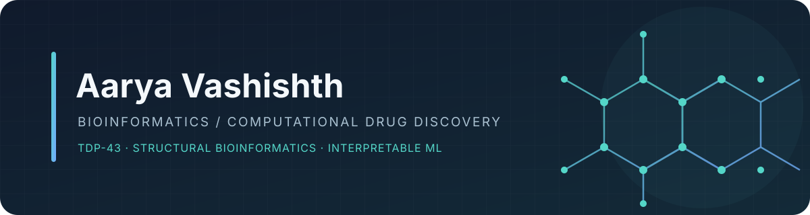

  

### Bioinformatics · Computational Drug Discovery · Machine Learning

*I use computation to make complex biology easier to explore.*

---

## About me

I’m Aarya, a bioinformatician interested in the space where molecular biology, chemistry, and machine learning meet. My work has focused on computational approaches to drug discovery: preparing molecular data, asking better questions of structural models, and interpreting predictions with care.

My **MSc Bioinformatics dissertation at the University of Edinburgh** explored fragment-based design of synthesizable binders for **TDP-43**, a protein linked to ALS and frontotemporal dementia.

## Featured research

### AI-enhanced fragment-based design for TDP-43

A computational workflow spanning NMR ensemble preparation, fragment screening, interaction analysis, pharmacophore-guided chemical elaboration, and machine-learning rescoring with SHAP interpretation.

- **11,267 fragments** screened across **five** TDP-43 conformers
- **~8,000** elaborated lead-like candidates explored
- **7,013 compounds** rescored with SCORCH2 and interpreted using SHAP
- Identified and corrected a docking-grid setup that improved literature-contact recovery from **86% to 97%**

These are computational screening results and hypotheses for follow-up, not experimentally validated binders.

[**Explore the dissertation code →**](https://github.com/aaryavashishth-beep/Masters)

## Research interests

Structural bioinformatics · Cheminformatics · Fragment-based drug discovery · Molecular docking · Machine learning for biology · Interpretable AI

## Tools

**Python** · **RDKit** · **XGBoost** · **scikit-learn** · **SHAP** · **ChEMBL** · Molecular docking · Data analysis

## More work

- [TDP-43 dissertation — fragment screening, elaboration, and rescoring](https://github.com/aaryavashishth-beep/Masters)
- [Early molecular screening experiments with XGBoost](https://github.com/aaryavashishth-beep/Novel-Molecules-using-XGBoost)

## Find me

[LinkedIn](https://www.linkedin.com/in/aarya-vashishth-269930237/) · [ORCID](https://orcid.org/0009-0009-1658-1157)

---

  Curious about molecules, careful with models, always learning.

